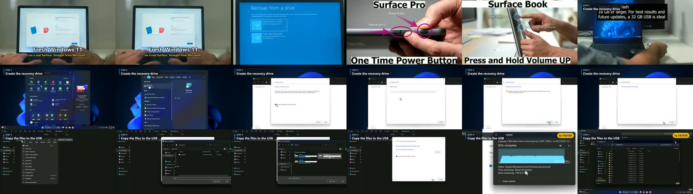

# tutorial-forge

Turn a long, raw screen recording and a voiceover into a tight, YouTube-ready tutorial, from a short JSON plan instead of hours on a timeline.



## Why

Raw tutorial footage is mostly waiting: progress bars, file copies, reboots. Editing it by hand means cutting each wait, speeding it up, adding a label, punching in on every dialog and keeping the voice in sync. tutorial-forge does all of that from a plan like this:

```json
{
  "source": "raw/install.mp4",
  "output": "edit/install.mp4",
  "sections": [
    { "headline": "Fresh Windows 11", "subline": "Straight from Microsoft.",
      "voice": "voice/voice-01.wav",
      "clips": [{ "start": 1186, "end": 1192, "speed": 1 }] },
    { "step": "STEP 3", "title": "Create the recovery drive",
      "voice": "voice/voice-02.wav",
      "clips": [{ "start": 115, "end": 128 },
                { "start": 128, "end": 150, "zoom": [1.2, 0.44, 0.45] }] }
  ]
}
```

## What it does

- **Fits footage to the voice.** Each section lasts exactly as long as its voiceover. Clips without a fixed `speed` share the remaining time, so a 30-second file copy under a 6-second sentence plays at 5x.
- **Marks the speed-ups.** Anything at 3x or faster gets a "5x FASTER" badge, so viewers know time was cut.
- **Adds eased punch-ins.** `zoom: [factor, x, y]` smoothly pushes in on a dialog so small UI text is readable on a phone.
- **Labels each step.** A top-left label shows the step number and title.
- **Opens with a hook.** A section with a `headline` gets a big centred title, so the video can open on the result instead of "hello everyone".
- **Grades and levels.** A light contrast and saturation lift with sharpening, a highpass on the voice, 30 ms fades at every cut against pops, and loudness normalized to YouTube's -14 LUFS.
- **Writes YouTube chapters.** `<output>-chapters.txt` is ready to paste into the description, starting at 0:00 as YouTube requires.
- **Splits one take into sections.** Record the whole script in one go, and `split-voice` cuts it at the longest pauses and trims the silence.
- **Gives you a placeholder voice.** `voice_text` uses Windows' built-in speech, so you can check pacing before you record.

## Usage

```bash
pip install -r requirements.txt          # Pillow; ffmpeg must be installed too

python forge.py split-voice voice.wav 10 # one long take -> voice/voice-01.wav ... voice-10.wav
python forge.py render plan.json         # -> the video + chapters
python forge.py preview edit/out.mp4     # -> contact sheet to review the cut
```

ffmpeg is found on `PATH`, in `FFMPEG_DIR`, or in winget's link folder on Windows.

## How it works

Each clip is extracted and rendered on its own (speed with `setpts`, an eased `scale`+`crop` punch-in, PNG overlays drawn with Pillow), then the parts are joined with a lossless concat. The voice blocks are padded to their section lengths, joined and loudness-normalized in one pass, then muxed over the video. Rendering per segment keeps every cut frame-accurate and avoids re-encoding the whole video when one section changes.

See [examples/surface-sample.json](examples/surface-sample.json) for a full plan.

## License

MIT
